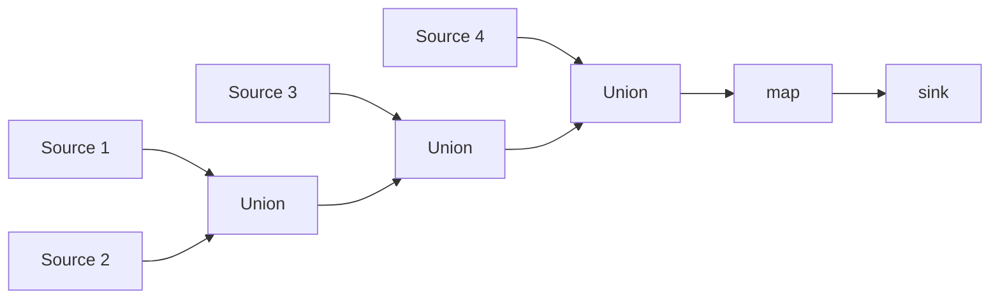
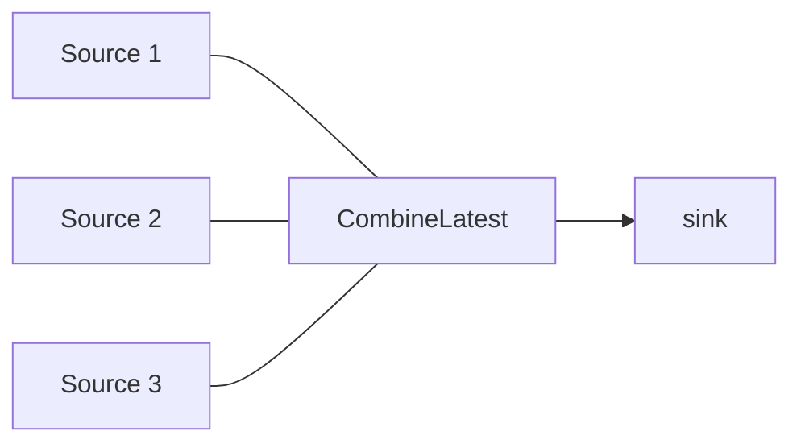
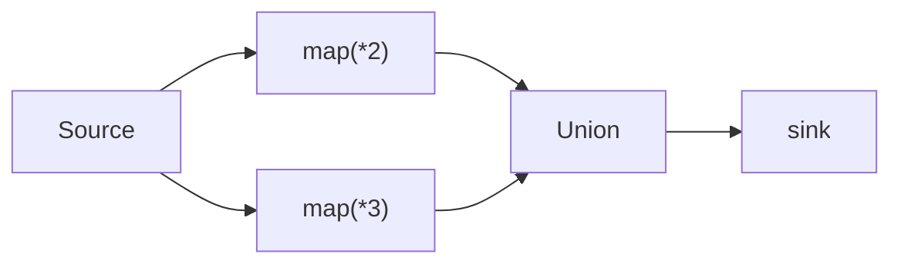
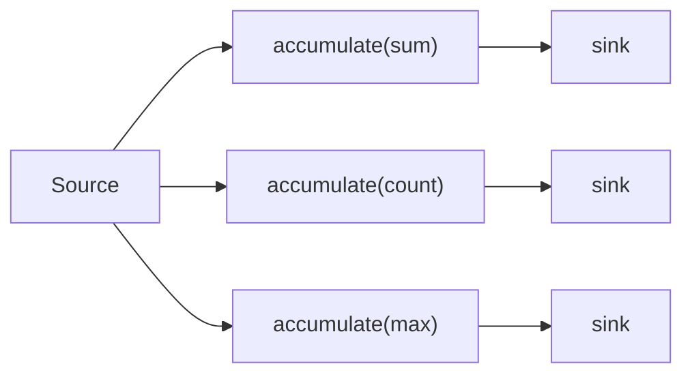
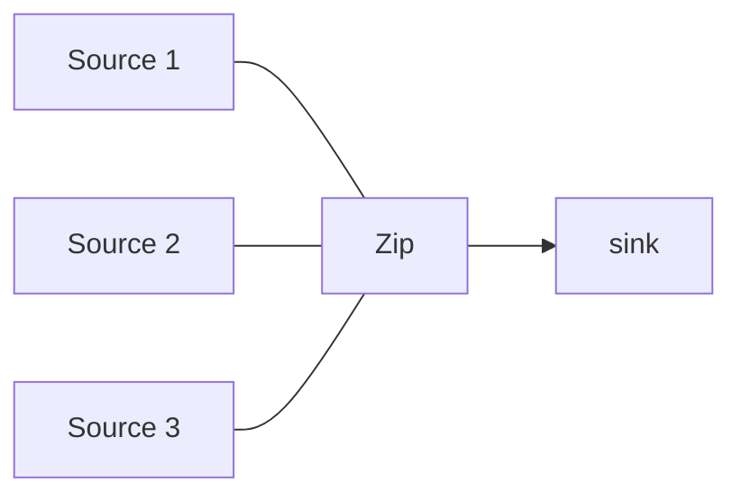
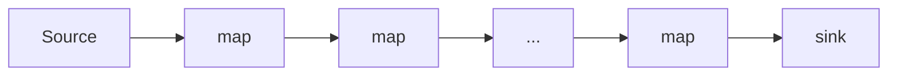
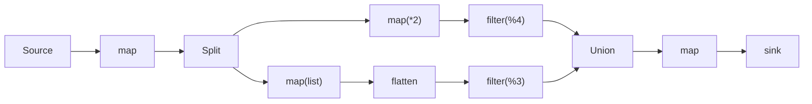
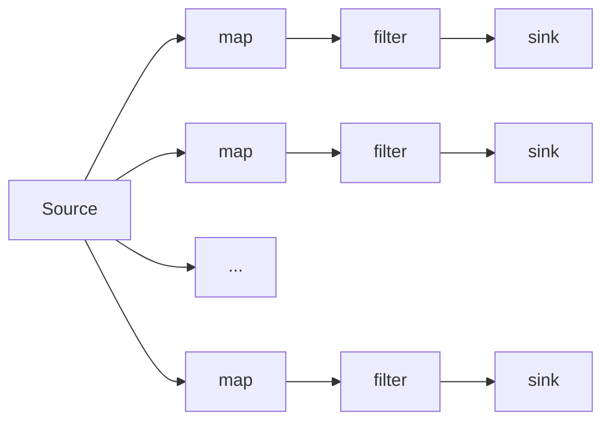

# Benchmarks

`akayu` against the original `streamz` library and hand-written Python, on the topologies
described under [Benchmark Details](#benchmark-details).

**Environment:** Python 3.13.11, Linux x86_64 (AMD Ryzen 7 PRO 4750G, shared machine),
500,000 items per run, mean of 5 runs after a warm-up, `tests/bench_complex.py`.

## Summary

| Topology Type | Scenario                    | Speedup over streamz |
| ------------- | --------------------------- | -------------------- |
| Deep Chains   | 10 chained maps             | **~58x**             |
| Branching     | Fan-out, diamond            | **~34x - 45x**       |
| Merging       | Union, zip, combine_latest  | **~32x - 63x**       |
| Complex DAG   | Split, flatten, union mixed | **~31x**             |

## Complex Flow Topologies (500k items)

Every akayu graph is compiled with `compile()`. "Pure Python" is a hand-written loop with the
operations inlined: no functions are called, so it is a floor rather than an equivalent
program.

| Topology                                        | akayu (ms) | akayu `emit_batch` (ms) | streamz (ms) | Pure Python (ms) | vs streamz     |
| ----------------------------------------------- | ---------: | ----------------------: | -----------: | ---------------: | -------------- |
| [Deep pipeline (10 maps)](#deep-pipeline)       |        319 |                     255 |       18,656 |              253 | **58x faster** |
| [Diamond (split → union)](#diamond)             |        215 |                     198 |        9,778 |               80 | **45x faster** |
| [Fan-out (5 branches)](#fan-out)                |        516 |                     508 |       17,509 |              262 | **34x faster** |
| [Complex DAG](#complex-dag)                     |        453 |                     416 |       14,142 |              107 | **31x faster** |
| [Multi-union (4 sources)](#multi-union)         |        122 |                       - |        7,654 |               45 | **63x faster** |
| [Accumulate (3 branches)](#accumulate-branches) |        307 |                       - |        9,013 |              122 | **29x faster** |
| [Zip (3 sources)](#zip)                         |        203 |                       - |        9,202 |               50 | **45x faster** |
| [Combine latest (3 sources)](#combine-latest)   |        132 |                       - |        4,232 |               50 | **32x faster** |

**Observations:**

- akayu is 29x - 63x faster than streamz on every topology.
- Most of akayu's remaining time is CPython running the pipeline's own functions: measured in
  instructions, akayu's own code is about 17% of a plain pipeline. The gap to hand-written Python
  is mostly the function calls a hand-written loop doesn't make.
- `emit_batch()` helps most on long linear chains (deep pipeline: 319 -> 255 ms). Below a
  fan-out, items still go through the branches one at a time, so batching gains little there.

## Running Benchmarks

Wall-clock comparisons with streamz and plain Python (the tables above):

```bash
just build-release
uv run python tests/bench_complex.py
```

Instructions per item for every workload and mode, plus memory per node. Instruction counts don't
change with machine load, so they can be compared between runs on a busy machine:

```bash
just bench-cost --save before.json   # ...change something...
just bench-cost --compare before.json
```

The pytest-benchmark suite: `just bench`.

## Benchmark Details

Each topology processes 500,000 items. Timing includes building and compiling the graph.

### Basic pipeline (`just bench`)

The pytest-benchmark suite's main pipeline:

- `map(lambda x: x + 1)`
- `filter(lambda x: x % 2 == 0)`
- `sink(results.append)`


### Multi-union

4 separate sources merged via union chain.



### Combine latest

3 sources combined, emitting tuples of latest values.



### Diamond

Single source splits to 2 branches, then merges via union.



### Accumulate branches

Single source with 3 parallel accumulate operations (sum, count, max).



### Zip

3 sources zipped together element-by-element.



### Deep pipeline

10 chained map operations.



### Complex DAG

Split with one branch using flatten, then union.



### Fan-out

Single source with 5 parallel map→filter→sink branches.


