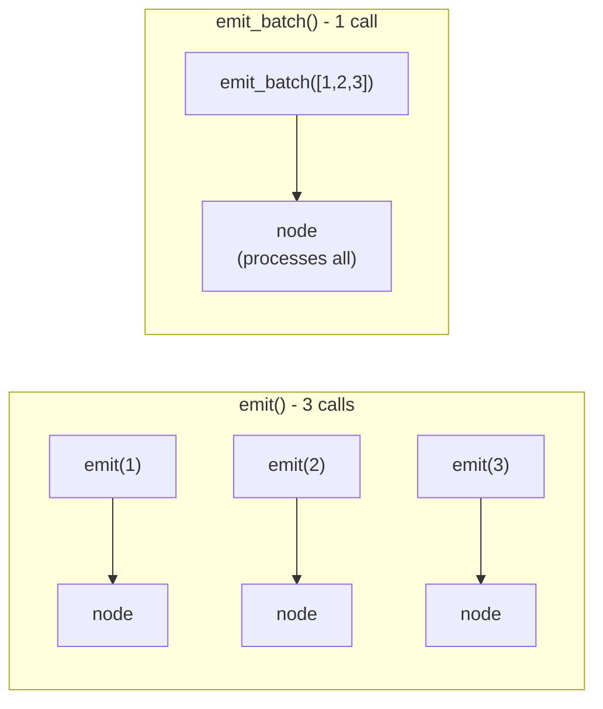
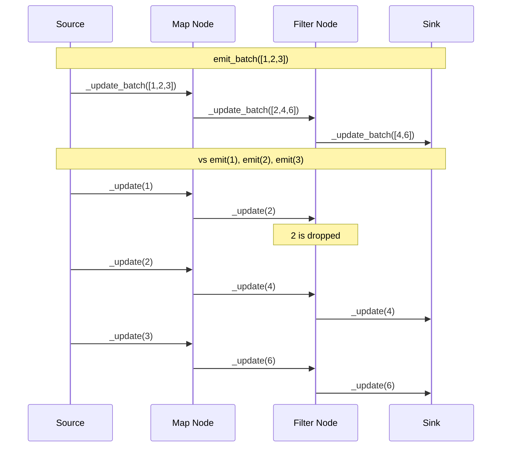
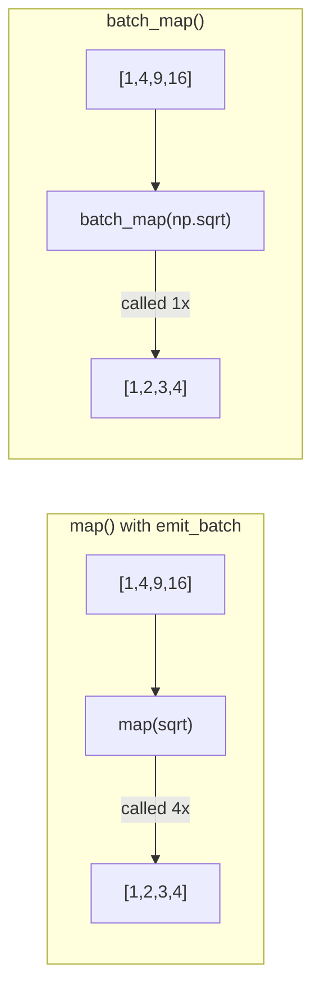
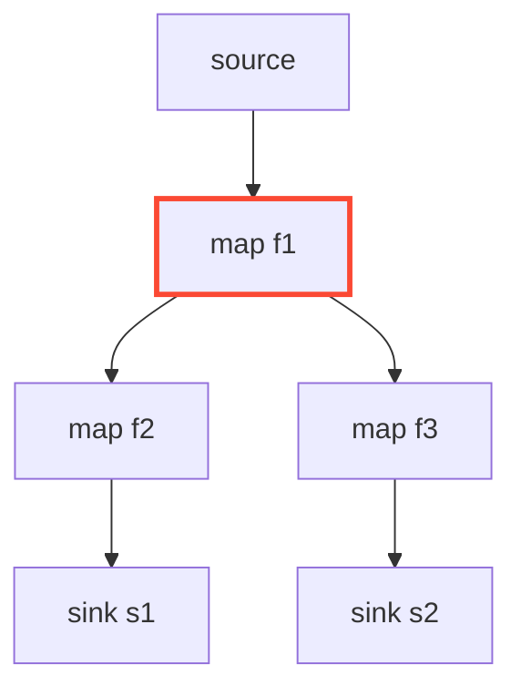
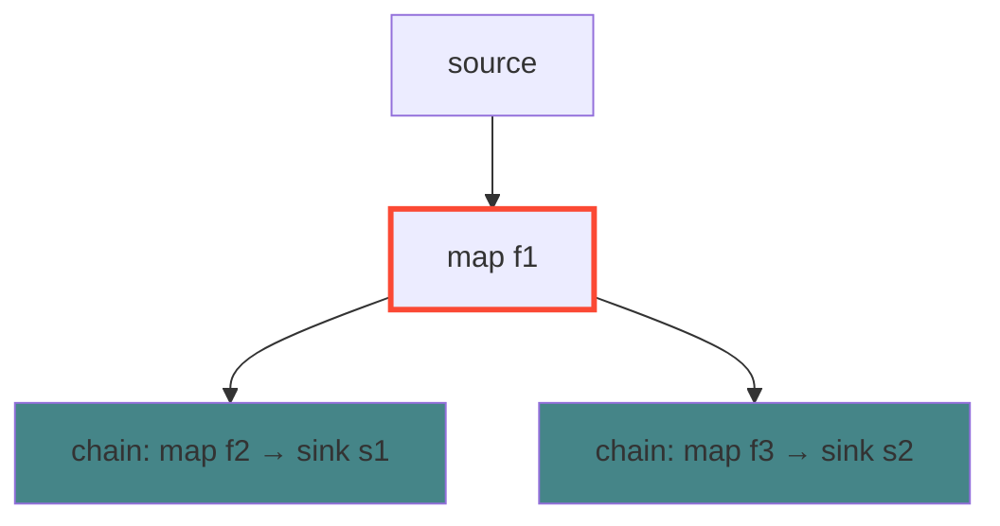
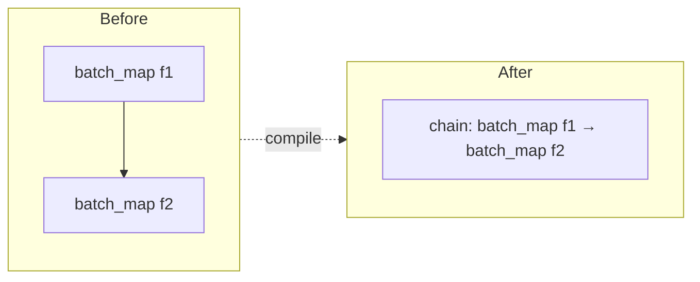
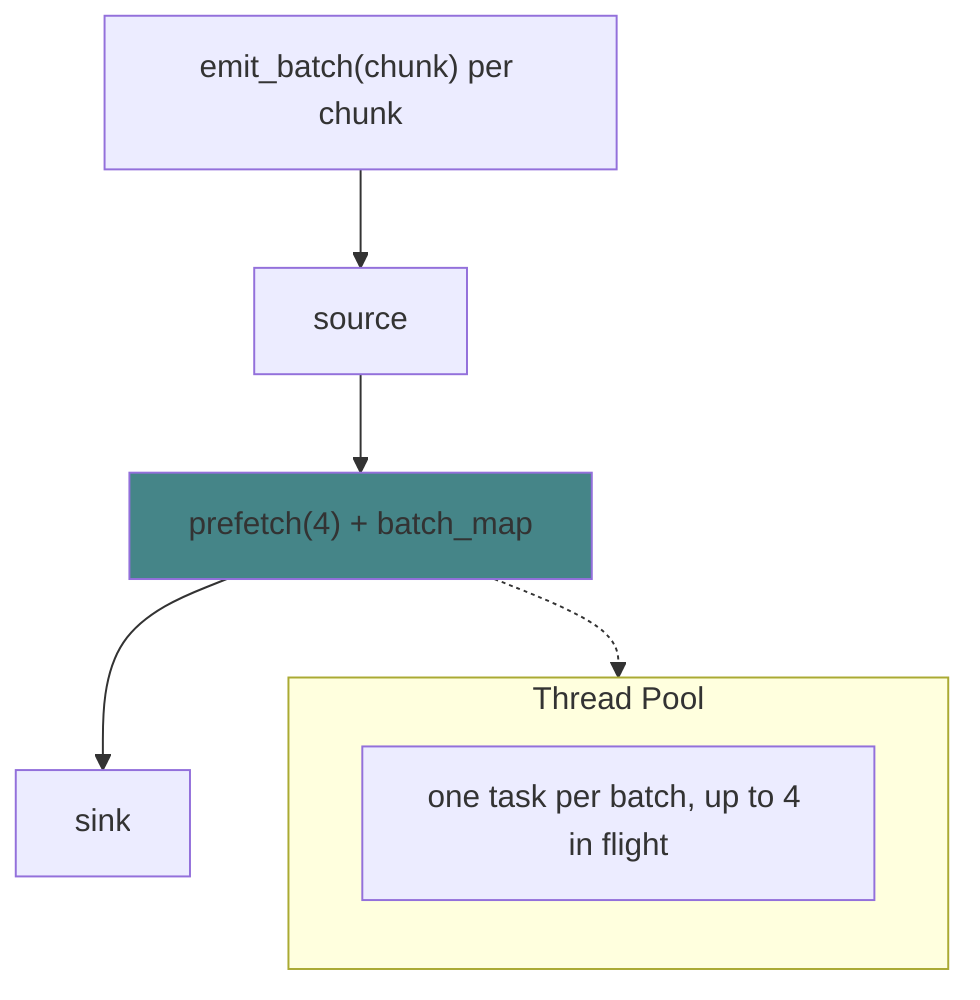
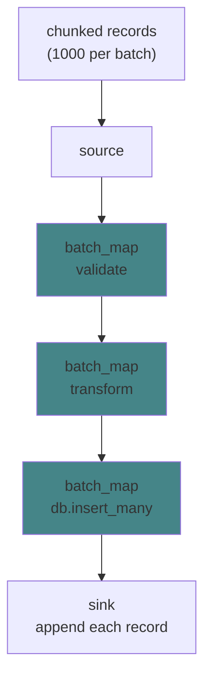
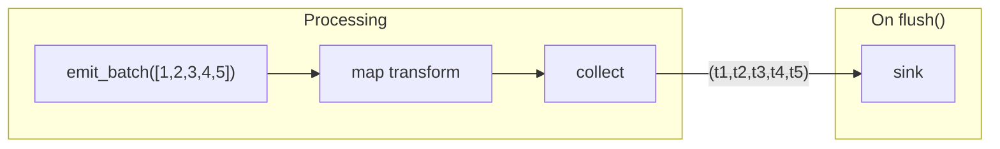

# Batch Processing

akayu provides efficient batch processing capabilities for high-throughput data pipelines. Understanding when to use `emit()` vs `emit_batch()` and how batch operations interact with optimizations can significantly improve performance.

## `emit()` vs `emit_batch()`

### `emit(x)` - Single Item

Pushes one item through the pipeline:

<!--pytest.mark.skip-->

```python
source.emit(1)
source.emit(2)
source.emit(3)
```

Each call traverses the stream graph independently.

### `emit_batch(items)` - Multiple Items

Pushes multiple items through the pipeline together:

<!--pytest.mark.skip-->

```python
source.emit_batch([1, 2, 3, 4, 5])
```



A batch goes through the pipeline step by step: each step processes every item before the next
step starts (below a branch point, items go through the branches one at a time, unless
`compile()` proves the branches independent). So if a step fails, the batch stops there, and the
steps after it have seen none of the items. The items `flatten()` or a `batch_map()` makes from
one item continue the same way, also under `emit()`.

**Benefits of `emit_batch()`:**

- Reduced per-item overhead
- Better cache locality
- Enables vectorized operations with `batch_map()`
- More efficient for bulk data processing

How much `emit_batch()` saves depends on the pipeline: it helps most on long linear chains (the
deep-pipeline benchmark takes 100 ms instead of 137 ms) and little below a fan-out. See
[Benchmarks](../benchmarks.md).

## Internal Mechanics

Internally, `emit_batch()` hands each node the whole batch (the private `_update_batch()`)
where `emit()` hands it one item (`_update()`). For `map(lambda x: x * 2).filter(lambda x: x > 2).sink(...)`:



Each node type handles batches efficiently:

- **Map**: Applies function to each item, returns transformed batch
- **Filter**: Returns batch of items that pass predicate
- **Flatten**: Expands all iterables, returns flattened batch
- **BatchMap**: Calls function once with entire batch. Under `emit(x)` it is called with `[x]`,
  and below a branch point, where a batch goes through the branches one item at a time, it is
  called once per item with a one-item list (compiled or not)
- **Sink**: Calls function for each item (side effects)

## `batch_map()` - Vectorized Operations

Use `batch_map()` when your function can process multiple items at once:

<!--pytest.mark.skip-->

```python
import numpy as np
import akayu

source = akayu.Stream()
results = []

# Function receives list, returns iterable
source.batch_map(np.sqrt).sink(results.append)
source.compile()

source.emit_batch([1, 4, 9, 16])
# Results: [1.0, 2.0, 3.0, 4.0]
```



### When to Use `batch_map()`

- NumPy/pandas operations on arrays
- Database batch queries
- API batch requests
- Any function optimized for bulk input

The function only sees a whole batch when the items arrive through `emit_batch()` and the
`batch_map()` isn't below a branch point (see the BatchMap bullet above): in a branch, a batch
query becomes one query per item.

<!--pytest.mark.skip-->

```python
def batch_db_lookup(ids):
    # Single query for all IDs
    return db.query("SELECT * FROM users WHERE id IN (?)", ids)

source.batch_map(batch_db_lookup).sink(process_user)
```

### `batch_map()` vs `map()` with `emit_batch()`

<!--pytest.mark.skip-->

```python
# map() with emit_batch: function called N times
source.map(lambda x: x * 2)
source.emit_batch([1, 2, 3])  # lambda called 3 times

# batch_map(): function called once
source.batch_map(lambda batch: [x * 2 for x in batch])
source.emit_batch([1, 2, 3])  # lambda called 1 time with [1, 2, 3]
```

## Optimization Boundaries at Splits

Chain fusion (combining consecutive operations) **stops at split points** where a node has multiple downstreams:

<!--pytest.mark.skip-->

```python
source = akayu.Stream()
branch = source.map(f1)

# Split: branch feeds two paths
branch.map(f2).sink(sink1)
branch.map(f3).sink(sink2)

source.compile()
```



**Why fusion stops at splits:**

- `f1` produces output consumed by both paths
- Can't fuse `f1` with `f2` because `f3` also needs `f1`'s output
- Each branch after the split is optimized independently

### After compile()



Each branch is fused into a chain (blue), but `f1` remains separate at the split point (red border).

### Working with Splits

If you need maximum fusion, consider restructuring:

<!--pytest.mark.skip-->

```python
# Less optimal: split prevents f1 fusion
source.map(f1).map(f2).sink(s1)  # Can't fuse f1 if split exists elsewhere

# More optimal: duplicate the common operation
source.map(lambda x: f2(f1(x))).sink(s1)
source.map(lambda x: f3(f1(x))).sink(s2)
```

However, this trades fusion for duplicate computation. Choose based on whether:

- `f1` is expensive (keep shared)
- Function call overhead dominates (fuse)

## BatchMap in Chains

Consecutive `batch_map()` steps join a chain like any other step: after `compile()` they run in
one node, and each function is still called in turn, with the whole batch:

<!--pytest.mark.skip-->

```python
source.batch_map(f1).batch_map(f2)

# After compile: one chain node; f1 gets the batch, then f2 gets f1's results
```



## Prefetch with Batch Operations

`prefetch(n).batch_map(f)` runs `f` on the thread pool, one batch at a time per task: each
`emit_batch()` call is one task, and `f` gets that whole batch on one pool thread. Batches from
successive `emit_batch()` calls run concurrently, up to `n` at once, and their results come out in
order. A single `emit_batch()` therefore gets no concurrency: split large inputs into several
batches. Once `n` batches are in flight, the oldest is finished and passed on; the last `n - 1`
stay in flight until more batches arrive or you call `flush()`:

```python
import time

import akayu

def batch_process(batch):
    time.sleep(0.01)  # e.g. one request for the whole batch
    return [x * 2 for x in batch]

source = akayu.Stream()
results = source.prefetch(4).batch_map(batch_process).to_list()

for start in range(0, 100, 10):
    source.emit_batch(list(range(start, start + 10)))  # one task per batch
print(len(results))  # 70: three batches still in flight

source.flush()  # wait for them
print(len(results))  # 100
```



## Example: Efficient Data Pipeline

<!--pytest.mark.skip-->

```python
import akayu

def validate_batch(records):
    return [r for r in records if r.get("valid")]

def transform_batch(records):
    return [{"id": r["id"], "value": r["value"] * 2} for r in records]

def batch_insert(records):
    db.insert_many(records)
    return records  # Return for downstream

source = akayu.Stream()
inserted = []

(source
    .batch_map(validate_batch)
    .batch_map(transform_batch)
    .batch_map(batch_insert)
    .sink(inserted.append))  # batch_map passes each record on as its own item

source.compile()

# Process in batches for efficiency
for chunk in chunked(all_records, 1000):
    source.emit_batch(chunk)

source.flush()
```



After compile(), the three `batch_map` steps and the sink run as one chain: each function is
called once per chunk, in turn.

## Collecting Results

Use `collect()` to buffer items and `flush()` to emit them as a batch:

<!--pytest.mark.skip-->

```python
source = akayu.Stream()
collected = source.map(transform).collect()
results = []
collected.sink(results.append)

source.compile()

source.emit_batch([1, 2, 3, 4, 5])
source.flush()  # Emits (transformed_1, transformed_2, ...) as tuple

print(results)  # [(<all transformed items as tuple>)]
```



The `collect()` node buffers all items until `flush()` is called, then emits them as a single tuple.
