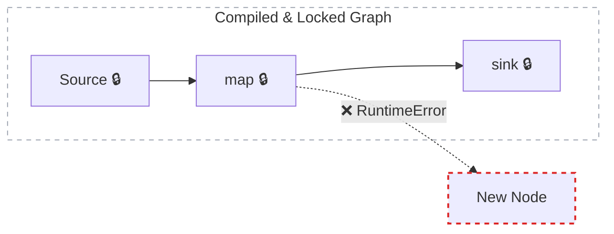
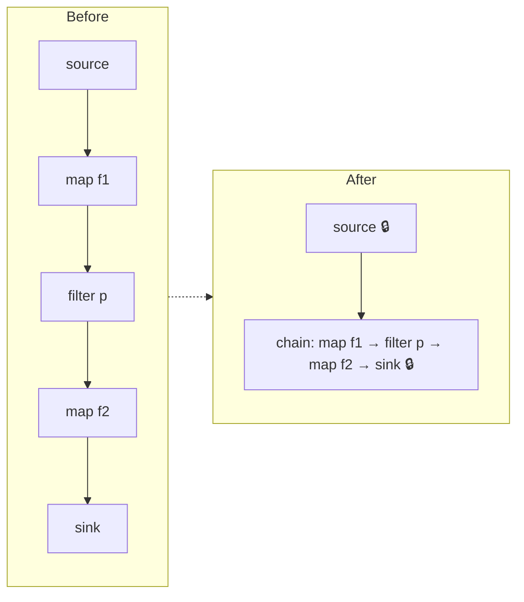
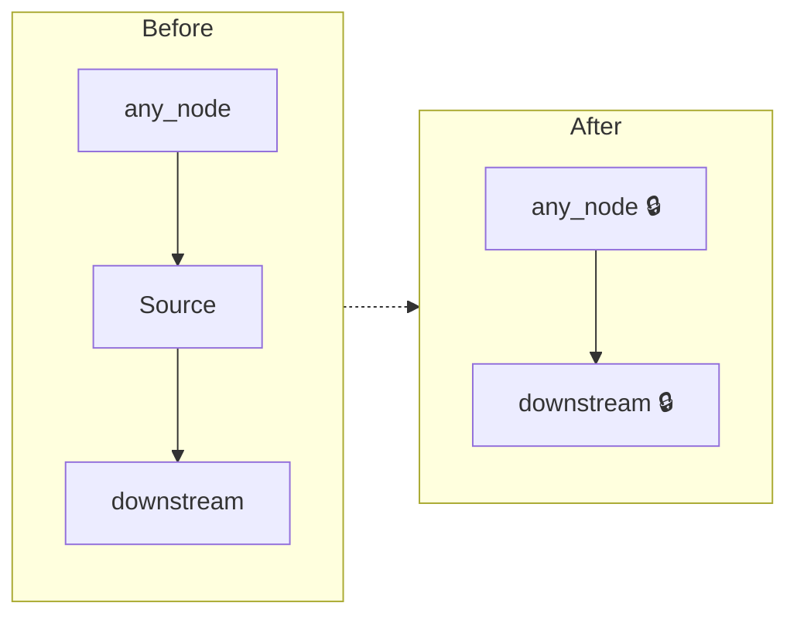
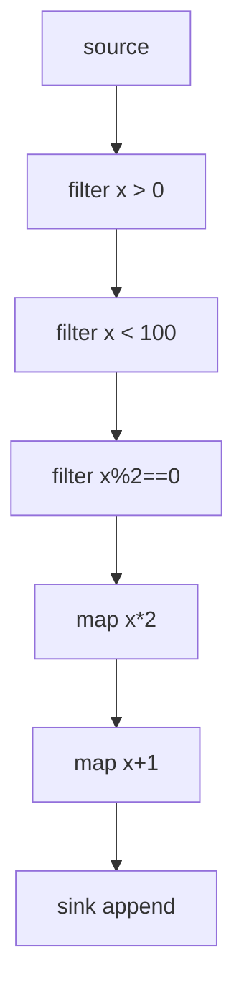
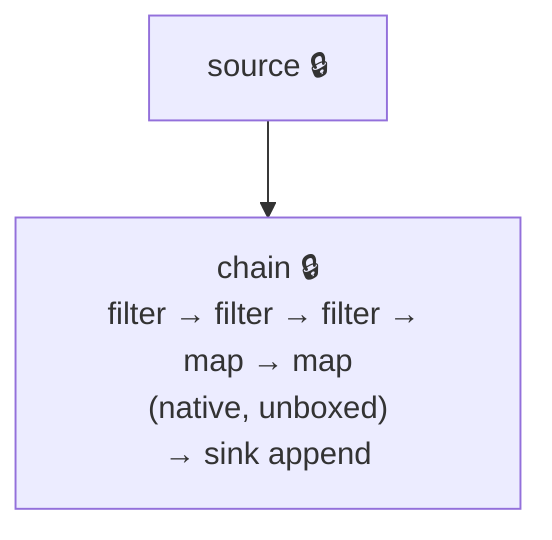
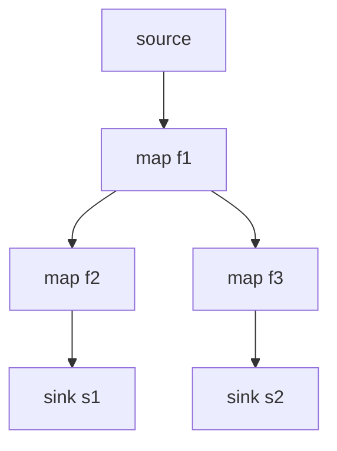
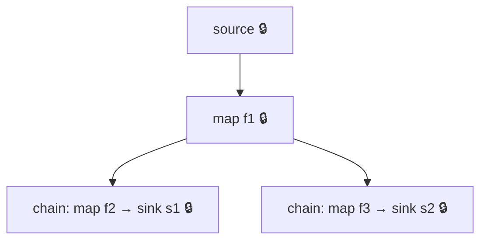

# Compile Optimizations

akayu includes an optimization pass that rewrites your stream graph for speed. Call `.compile()` on each source stream after building the pipeline to enable it.

## What `.compile()` Does

When you call `.compile()`, akayu:

1. **Freezes the topology** - Prevents further modifications to the graph below the stream
1. **Fuses chains** - Runs each linear run of steps as one node, see [Chain Fusion](#chain-fusion)
1. **Runs simple functions natively** - see [Native Operations](#native-operations)
1. **Shares one lock across the graph** - see [Proven Fast Paths](#proven-fast-paths)
1. **Locks converging `par()` branches** - When two branches of a `par()` reach a common node,
   every node in its branches gets its own lock
1. **Fuses the chunking idiom** - `collect()` plus `filter(p).sink(lambda _: c.flush())` on the
   same parent becomes one `chunk_by` node
1. **Warns about a useless `par()`** - A `par()` with one branch or none issues a `UserWarning`:
   it only adds thread-pool dispatch

<!--pytest.mark.skip-->

```python
source = akayu.Stream()
source.map(f1).map(f2).filter(p).sink(print)

# Apply optimizations
source.compile()

# Graph is now frozen - this would raise RuntimeError:
# source.map(another_func)
```

## Graph Locking & Immutability

It is critical to understand that `.compile()` transforms your dynamic graph into an **immutable, optimized execution engine**.

### The Locking Effect

When you call `.compile()` on a stream:

- Every node reachable from it (downstream) is traversed.
- Each of those nodes is marked as `compiled`.
- Any subsequent attempt to call a transformation method (like `.map()`, `.filter()`, `.sink()`, etc.) on one of those nodes raises a `RuntimeError`.
- Calling `.compile()` a second time on the same stream raises `RuntimeError: Stream '...' is already compiled`.

Nodes that are not downstream of the stream stay open. In a graph with several sources
(`union`, `zip`, `combine_latest`), `s1.compile()` compiles the merge and everything below it,
but not `s2`: `s2.compiled` is still `False`, and nodes can still be added to it. Call
`compile()` on every source; [`MultiStream.compile()`](multistream.md) does this for each of
its streams. Likewise, compiling a node below the source leaves the source open.

### Example of Modifying a Compiled Graph

<!--pytest.mark.skip-->

```python
source = akayu.Stream()
branch = source.map(lambda x: x + 1)

source.compile()

# RuntimeError: Cannot modify frozen stream 'map(<lambda>)'.
# Call compile() only after building the complete graph.
new_node = branch.map(lambda x: x * 2)
```



This locking mechanism is necessary because many optimizations (like [Chain Fusion](#chain-fusion)) physically merge nodes and change the underlying propagation logic, making it impossible to safely attach new branches to the original structure.

## Chain Fusion

Each linear run of `map()`, `starmap()`, `filter()`, `flatten()`, `accumulate()`,
`batch_map()` and `sink()` steps becomes one chain node, which runs the steps in a flat loop:



Every function is still called in turn (unless it runs [natively](#native-operations)); nothing
is composed. What fusion removes is the per-node work between the steps: borrowing each node and
propagating to it. A filter that drops an item ends the chain for it, so
the later steps aren't called. Profiles and error messages still name each step:

```text
RuntimeError: Stream operation failed at node 'map(<lambda>)' (defined at app.py:12)
```

**Benchmark impact**: a compiled pipeline of 10 chained maps runs about 142x faster than streamz (see [Benchmarks](../benchmarks.md)); fusion makes the 10 nodes one.

A chain ends at:

- a node with several downstreams (a **split point**, see [Limitations](#limitations));
- a merge (`union()`, `zip()`, `combine_latest()`), or any node with more than one parent;
- a `sink()`;
- any node that isn't one of the steps above: `collect()`, `chunk_by()`, `chunks_between()`,
  `par()` / `seq()`, and the step that follows a `prefetch()`.

A chain of one step is left as it is.

## Source Elimination

Intermediate `Source` nodes that only forward values (those created by `seq()`, or by a
`union()` with a single input) are bypassed:



A `seq()` directly below `par()` is kept: it is what keeps the nodes after it sequential.

## Native Operations

`compile()` reads the bytecode of each function and replaces simple ones with native operations,
so no Python function call happens per item. Recognized shapes include:

- One step on the item: `x + 1`, `x % 2`, `x > 3`, `x["key"]`, `x.attr`, `x.strip()`,
  `x.get("k", 0)`, `len(x)`, `str(x)`, `x in allowed`, `x is None`, `not x`, `x[1:]`
- Chains of such steps: `x % 2 == 0`, `x * 2 + 1`, `x["a"]["b"]`, `str(x).upper()`
- `and` / `or` of them, and tuples/lists of them: `(x["a"], x["b"])`
- Extra parameters with defaults, the loop-variable idiom: `lambda x, k=k: x + k`
- Accumulators, with `returns_state=False`: `acc <op> x` and `acc <op> constant` for
  `+ - * / // % **` (the accumulator first: `x + acc` is still called), `max(acc, x)`,
  `min(acc, x)`
- Sinks: `sink(results.append)` on a list, `sink(print)`

Builtin callables passed directly also run natively after `compile()`: `map(len)`, `map(str)`,
`map(int)`, `map(float)`, `map(bool)`, `map(type)`, `map(tuple)`, `map(list)`, `map(set)`,
`map(frozenset)`, `map(operator.not_)`, `map(operator.truth)`, `map(operator.itemgetter(k))`
with one key, `map(operator.attrgetter("a.b"))` with one name (dotted paths are followed),
`filter(isinstance, T)`, `filter(operator.is_, v)` and `filter(operator.is_not, None)`.

Values from closures, defaults and globals are read once, at `compile()`. Functions that use the
item twice (`x * x`), branch (`0 < x < 10`) or do anything else still run as Python calls.

`map()` and `filter()` lambdas whose native form depends on nothing but their own code
(`lambda x: x + 1`, `lambda x: x["k"]`, `lambda x: x.strip()`) run natively even before
`compile()`: there is no closure, default or global value it would have to read once. Builtin
names count as globals, so `lambda x: len(x)` and `lambda x: str(x).upper()` are called until
`compile()`. Everything else is called until `compile()`: other steps (`accumulate()`, `sink()`,
builtin callables); lambdas that read closure, default or global values (`lambda x: x + k`,
`lambda x: x in allowed`), so late binding holds; `def` functions, so coverage and breakpoints
in their bodies work as usual; and a function whose code was replaced in place (IPython's
autoreload does that).

A method call on an item of a builtin type (`x.strip()` on a `str`, `x.get("k", 0)` on a `dict`)
calls that type's C method directly: builtin types can't be changed, so `compile()` looks the
method up once. Other items, including subclasses that may override it, look it up per call.

Arithmetic and comparisons with numeric constants (`+ - * / // %` and `== != < > <= >=`) also
run unboxed on ints and floats: an item is converted to a machine integer or float once, every
such step in a row (`.map(lambda x: x * 2 + 1).filter(lambda x: x % 3 == 0)`) works on it
without allocating a Python number, and the result is converted back once. Results are exactly
Python's; whatever the machine version can't do identically (bools, integers beyond 64 bits or
overflowing them, division by zero, `**`, float `//` and `%`, int/float mixes beyond 2\*\*53)
takes the ordinary path for that item.

## Proven Fast Paths

Some checks are only needed when the graph could be used in a way `compile()` can rule out:

- **One lock for the graph.** Merges of several sources (`union`, `zip`, `combine_latest`) lock
  each item, in case the sources are emitted from different threads. Each `emit()` already takes
  a lock, so when every node in the connected graph shares one lock, two threads can't be in the
  graph at once. `compile()` gives a graph without `par()` one shared lock and drops the per-item
  merge locks.
- **Independent branches in batches.** Below a branch point, `emit_batch()` passes items through
  the branches one at a time (item 1 through every branch, then item 2, ...), so the branches'
  side effects interleave as with `emit()`. When every node in the branches is a native operation
  and each branch appends to its own list, that order can't be observed: each branch takes the
  whole batch instead, which is faster. (If a step raises halfway, the branches before it will
  have processed the whole batch.)

## When to Use `.compile()`

**Use compile when:**

- Your pipeline topology is fixed before processing begins
- You're processing many items through the same pipeline
- Performance is critical

**Don't use compile when:**

- You need to dynamically add nodes during processing
- The pipeline is used once for a single item
- You're still debugging and iterating on the pipeline structure

## Example: Optimization in Action

```python
import akayu

source = akayu.Stream()
results = []

# Build a pipeline that will benefit from fusion
(source
    .filter(lambda x: x > 0)      # Six steps in a line:
    .filter(lambda x: x < 100)    # fused into one chain
    .filter(lambda x: x % 2 == 0)
    .map(lambda x: x * 2)         # The numeric steps run natively,
    .map(lambda x: x + 1)         # on machine integers
    .sink(results.append))        # A direct list append

# Apply optimizations
source.compile()

# Process data through optimized pipeline
source.emit_batch(range(200))
print(len(results))  # 49
```

**Before: 7 nodes**



**After: 2 nodes**



## Checking Compilation Status

```python
import akayu

source = akayu.Stream()
child = source.map(lambda x: x)

print(source.compiled)  # False

source.compile()

print(source.compiled)  # True
print(child.compiled)   # True (all reachable nodes are compiled)
```

## Limitations

Fusion stops at **split points** where a node has multiple downstreams:



The orange-bordered node is a **split point** - it has multiple downstreams, so `f1` cannot be fused with `f2` or `f3`.

**After compile():**



Each branch after the split is fused into its own chain, but `f1` stays separate. The other
places a chain ends are listed under [Chain Fusion](#chain-fusion).

<!--pytest.mark.skip-->

```python
source = akayu.Stream()
branch = source.map(f1)

# Split: branch has two downstreams
branch.map(f2).sink(sink1)
branch.map(f3).sink(sink2)

source.compile()
# f1 cannot be fused with f2 or f3 because branch feeds both paths
```
