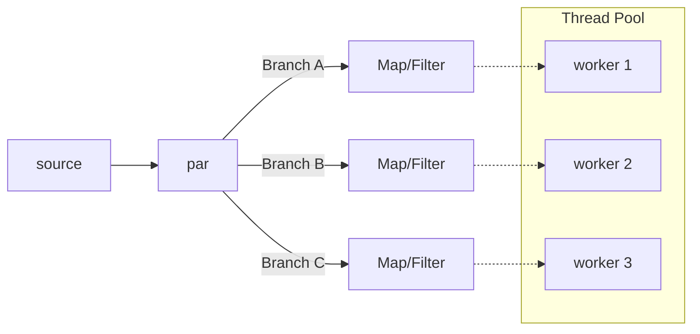
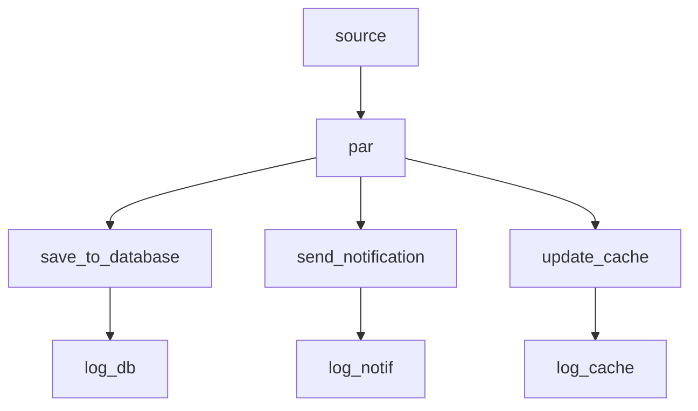
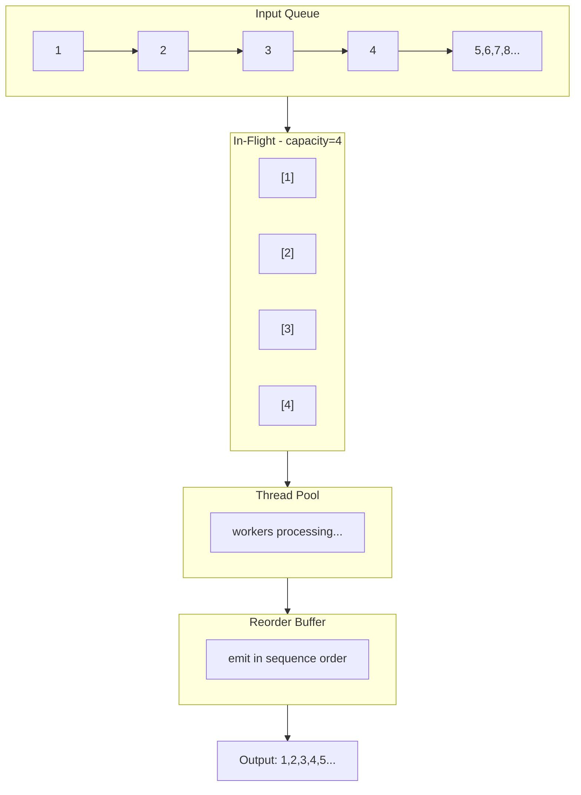
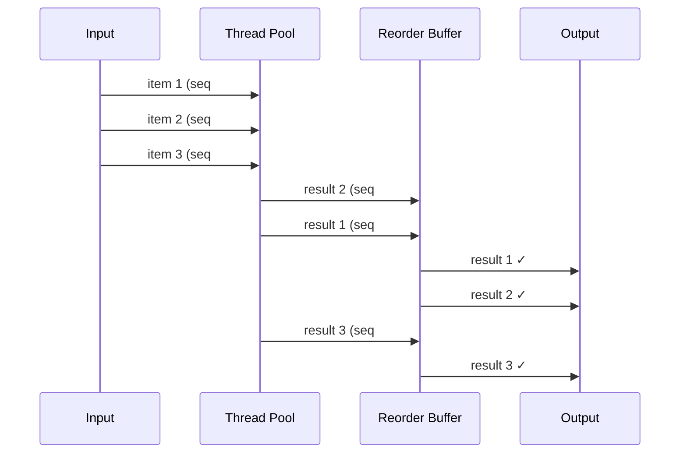
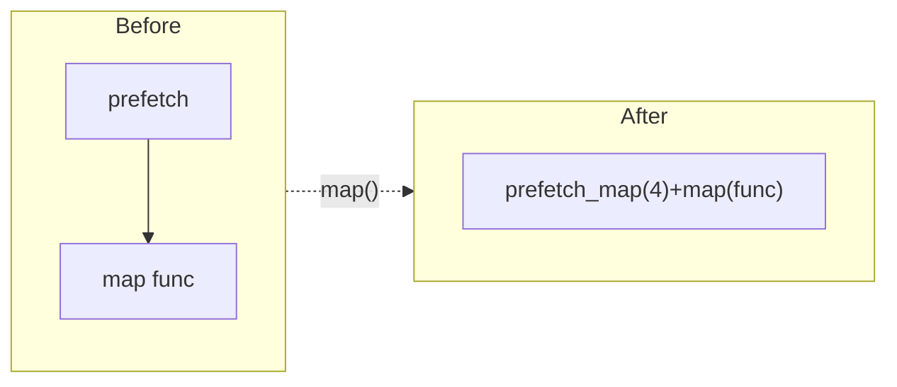
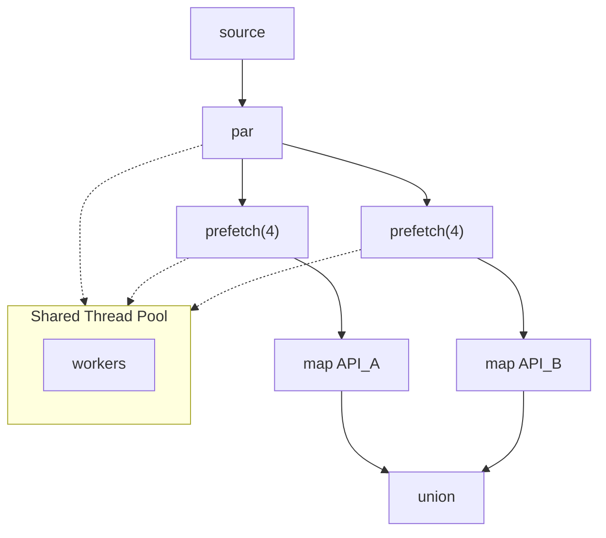
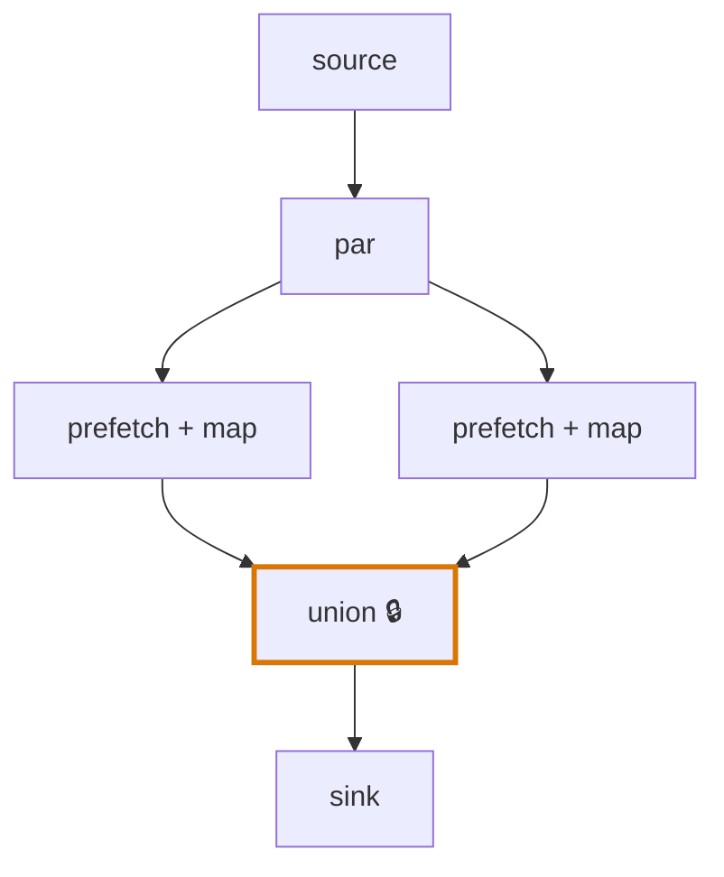
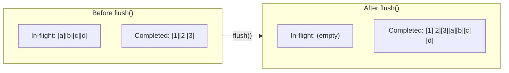
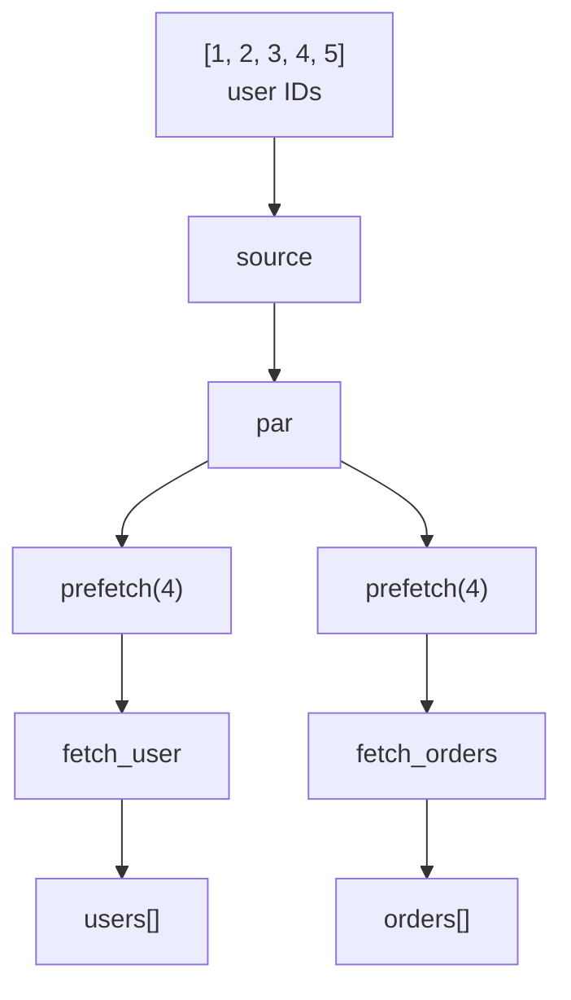

# Concurrency

akayu provides two mechanisms for concurrent processing that work efficiently together: `par()` for parallel branch execution and `prefetch()` for ordered concurrent processing within a single branch.

## `par()` - Parallel Branch Execution

The `par()` method creates a branch point where all downstream branches execute concurrently in a shared thread pool:

<!--pytest.mark.skip-->

```python
source = akayu.Stream()
p = source.par()

# These branches run in parallel
a = p.map(load_from_disk)
b = p.map(fetch_from_api)

# Merge results
merged = akayu.union(a, b)

source.emit(filename)  # a and b execute concurrently
```

### How `par()` Works



When a value reaches a `par()` node:

1. The value is submitted to all downstream branches
1. Each branch but the last runs on a worker thread from the [shared pool](#the-thread-pool); the last runs on the calling thread
1. Results flow to convergence points (like `union`) as they complete, and `emit()` returns once every branch has finished

**Timing comparison** (three branches that each wait 10ms on I/O):

| Mode       | Branch A | Branch B | Branch C | Total    |
| ---------- | -------- | -------- | -------- | -------- |
| Sequential | 0-10ms   | 10-20ms  | 20-30ms  | **30ms** |
| Parallel   | 0-10ms   | 0-10ms   | 0-10ms   | **10ms** |

Branches overlap only while they wait with the GIL released: network or disk I/O, `time.sleep()`,
or C code that releases the GIL. Callbacks run with the GIL held, so pure-Python computation in
several branches takes as long as running them one after another, plus the cost of dispatching
them (a fraction of a microsecond per branch per item). Free-threaded Python doesn't change this:
importing akayu turns the GIL back on.

### Use Cases for `par()`

- **I/O-bound operations**: When branches wait on disk, network, or database
- **Independent processing**: When branches don't depend on each other's results
- **Fan-out patterns**: Processing the same input multiple ways

Not CPU-bound Python: it gains nothing from `par()`.

<!--pytest.mark.skip-->

```python
source = akayu.Stream()
p = source.par()

# Fan-out: same data processed three ways
p.map(save_to_database).sink(log_db_result)
p.map(send_notification).sink(log_notification)
p.map(update_cache).sink(log_cache_update)

source.compile()
```



### Returning to Sequential

`seq()` adds a pass-through node. Directly below `par()`, it groups branches: the branches hung off
`p.seq()` form a single `par()` branch and run one after another on one thread, alongside `p`'s
other branches:

<!--pytest.mark.skip-->

```python
p = source.par()
q = p.seq()
q.map(step_one)   # step_one, then step_two, on one thread ...
q.map(step_two)
p.map(other_work)  # ... while other_work runs on another
```

Anywhere else it changes nothing at runtime. After `akayu.union(a, b).seq()`, the nodes below still
run on whichever thread delivers each item (a pool worker, for a `par()` branch); they see one item
at a time because the union locks, with or without the `seq()`.

## `prefetch()` - Ordered Concurrent Processing

The `prefetch(n)` method processes up to `n` items concurrently while **preserving output order**:

<!--pytest.mark.skip-->

```python
source = akayu.Stream()
source.prefetch(4).map(slow_operation).sink(results.append)
source.compile()

# Items processed concurrently but results arrive in order
source.emit_batch([1, 2, 3, 4, 5, 6, 7, 8])  # results: 1-5
source.flush()  # results: 1-8
```

### How `prefetch()` Works



1. Each incoming item is submitted to the thread pool as it arrives
1. Once `n` items are in flight, the oldest one's result is waited for and passed on, so results
   come out in input order
1. Backpressure: an item arriving with `n` in flight waits for the oldest
1. **The last `n - 1` results stay in flight** until more items arrive or `flush()` / `drain()` is
   called: a single `emit()` passes nothing on, and a long-running service runs `n - 1` items
   behind its input. Flush at the end of each batch, or on a timer.

At most `n` items are in flight, and at most [pool size + 1](#the-thread-pool) of them run at once.

**Order preservation:**



Even if item 2 finishes before item 1, it waits in the buffer until item 1 is emitted.

### Prefetch with Different Operations

`prefetch(n)` runs the `map()`, `filter()` or `batch_map()` called on it next. That call merges the
function into the prefetch node right away (not at `compile()`) and returns the prefetch node
itself:

<!--pytest.mark.skip-->

```python
source.prefetch(4).map(func)
source.prefetch(4).filter(pred)
source.prefetch(4).batch_map(vectorized_func)
```



- A second `.map()` on the same prefetch node chains after the first instead of branching:
  after `pf = source.prefetch(2)`, `pf.map(f)` then `pf.map(g)` gives `g(f(x))`. To prefetch two
  functions side by side, call `prefetch()` twice.
- Any other operation after `prefetch()` (`sink`, `starmap`, `accumulate`, ...) runs on the calling
  thread as if the `prefetch()` weren't there, without a warning.
- With `batch_map()`, one `emit_batch()` is one task: the function gets the whole batch on one
  worker, so batches overlap only with the batches of other `emit_batch()` calls.

### When to Use `prefetch()`

- **Slow per-item operations**: API calls, file I/O, image processing
- **Order-sensitive pipelines**: When downstream logic depends on item order
- **Rate-limited resources**: `n` caps the items in flight

<!--pytest.mark.skip-->

```python
# Process 4 images concurrently, results in original order
source.prefetch(4).map(process_image).sink(save_result)
source.emit_batch(images)
source.flush()  # the last 3 results
```

## Combining `par()` and `prefetch()`

`par()` and `prefetch()` share the same [thread pool](#the-thread-pool), so combining them has minimal overhead:

<!--pytest.mark.skip-->

```python
source = akayu.Stream()
p = source.par()

# Branch 1: prefetch for ordered concurrent I/O
a = p.prefetch(4).map(fetch_from_api_a)

# Branch 2: prefetch for ordered concurrent I/O
b = p.prefetch(4).map(fetch_from_api_b)

merged = akayu.union(a, b)
source.compile()
```



### The Thread Pool

The pool has one worker thread per CPU available to the process. It is shared by every `par()` and
`prefetch()` in the process, and its size can't be changed. A thread waiting for its branches or
prefetched items runs them too, so at most pool size + 1 run at once: on a 4-CPU machine,
`prefetch(16)` keeps 16 items in flight but runs 5 at a time, and the example above runs up to 5
API calls at once, not 8.

### Thread Safety at Convergence Points

Where `par()` branches meet again (a `union` or `zip` below them), items from several branches can
arrive at once, on different threads. akayu locks them:



The lock (🔒) lets one branch's item into the union at a time. `par()` branches run their nodes,
including the union and everything after it, on the pool threads. (`prefetch()` itself only runs
its function on the pool; the nodes after it run on the thread that emitted.)

<!--pytest.mark.skip-->

```python
p = source.par()
a = p.prefetch(4).map(f1)  # Internal threading
b = p.prefetch(4).map(f2)  # Internal threading
merged = akayu.union(a, b)  # Lock applied here
```

Where the locks are:

- Every merge (`union`, `zip`, `combine_latest`, as a method or a module function) locks the node it
  creates as soon as it is built, compiled or not, so its inputs may be emitted from different
  threads.
- Each item entering a `par()` branch takes that branch's lock.
- When `par()` branches converge, `compile()` marks every node in those branches to lock per item.
- In a graph without `par()`, `compile()` gives every node one shared lock instead: each `emit()`
  already takes it, so the per-item locks on merges are dropped.

### Callbacks, Re-entrancy and Limits

- `flush()` and `drain()` may be called from another thread (a timer flushing a `collect()`, an
  `atexit` handler) while other threads emit: they wait for a running emit to finish, and an
  `emit()`, or an item reaching the node being flushed, waits for a running flush. In an
  uncompiled graph, if that flush's callbacks emit into the source the waiting item came from,
  the item fails with an error instead of deadlocking; `compile()` lets the two take turns.
- Known limitation: in an uncompiled graph, `flush()` / `drain()` called on a node other than a
  source waits at most half a second for another thread's item inside that node, then raises a
  `RuntimeError` saying the node "is still processing an item (a callback flushed mid-emit…)",
  although no callback did. Flush the source instead (it reaches the same buffers), or `compile()`
  the graph; both wait for as long as the item takes.
- A callback may emit into another source. Emitting into a source that is itself mid-emit (from
  its own graph, through a `sink(source.emit)` or a loop of sources) fails with "Re-entrant emit
  detected", and an item that comes back into a node still processing another with "An item
  re-entered a node". Emitting into a source from a callback of its own `flush()` fails too. To
  feed results back, collect them and emit them after `emit()` returns.
- Adding nodes, compiling or stopping a profile from a callback, on the part of the graph that is
  running, raises a `RuntimeError`; the graph keeps working afterwards. The same goes for another
  thread doing so while an item passes through: build the graph before threads emit into it.
- Two threads whose callbacks emit into each other's sources can deadlock: each holds its own
  source's lock and waits for the other's. This happens whether or not the sources merge, compiled
  or not, with one exception: sources that merge (`union`, `zip`, `combine_latest`) in a graph
  without `par()`, compiled, share one lock, so the threads take turns. A thread waiting for a lock
  can't be interrupted (Ctrl+C takes effect only once it gets the lock), so a deadlocked process
  has to be killed. Hand such items to a queue instead of emitting them from the callback.
- Each node an item passes adds to the thread's native stack. A graph thousands of nodes deep, a
  long chain of sources feeding each other, or a thread with a small stack raises `RecursionError`
  when the stack is nearly used up, rather than crashing; so do `flush()` and `drain()`.
- An exception raised in a callback that isn't an `Exception` (`KeyboardInterrupt`, `SystemExit`,
  `GeneratorExit`, or your own `BaseException` subclass) reaches the caller as it is. Any other is
  wrapped in a `RuntimeError` naming the node ("Stream operation failed at node ..."), with the
  original as its `__cause__`; so are the errors above (a re-entrant emit raises a `RuntimeError`
  naming the node whose callback emitted, with "Re-entrant emit detected" as its `__cause__`).
- Locks belong to OS threads. Greenlets (gevent, eventlet) share one, so a greenlet emitting into
  a source that another greenlet is mid-emit in looks like a re-entrant emit and raises. Give each
  source a greenlet lock, or emit from one greenlet.
- After `os.fork()`, a graph inherited from the parent is safe to use only if no other parent
  thread was emitting into it at the time (a lock that thread held stays held in the child) and no
  prefetched items were in flight (they ran on the parent's workers, so the child's `flush()`
  waits for them forever). Flush prefetch nodes before forking. Graphs built in the child are
  always fine.
- Free-threaded Python (3.13t, 3.14t): akayu declares that it needs the GIL, so importing it turns
  the GIL back on (with a warning). On 3.13t, daemon threads still emitting when the interpreter
  exits can abort the process; join them first, or use 3.14t.

### Performance Characteristics

| Configuration           | Behavior                                        |
| ----------------------- | ----------------------------------------------- |
| `prefetch(n)` alone     | Up to n items in flight, ordered output         |
| `par()` alone           | Branches run in parallel                        |
| `par()` + `prefetch(n)` | Parallel branches, each with n items in flight  |

In every case, at most pool size + 1 calls run at once, and they overlap only while they wait with
the GIL released.

Benchmark showing minimal overhead when combining:

| Configuration           | Time (50 items, 10ms I/O each) |
| ----------------------- | ------------------------------ |
| `prefetch(4)` alone     | ~135ms                         |
| `par()` + `prefetch(4)` | ~136ms                         |

### Context, Errors and Nesting

- Each `par()` branch and each prefetched call runs in a copy of the calling thread's `contextvars` context: values set before `emit()` are visible, and changes made inside don't leak back. The exception is a `par()` with a single branch, which runs inline in the caller's context (`compile()` warns about such a `par()`: it gains nothing).
- The last `par()` branch runs on the calling thread. A thread waiting for its branches or prefetched items runs any of them that no worker has started yet, so nesting `par()` deeper than the pool can't deadlock.
- `par()` waits for every branch, then raises the error of the first failing branch (in the order the branches were added).
- A failed prefetched item raises once, from the later call that waits for its result: with
  `prefetch(2)`, item 1's error comes out of the `emit()` of item 2, or of a `flush()`. Results
  that finished before it are still delivered. After such an `emit()`, the next items carry on;
  an `emit_batch()` stops at that point, and the batch's items it hadn't started yet are dropped.
- Ctrl+C interrupts a thread that is waiting for branches or prefetched items. An `emit()`
  interrupted while waiting for a prefetched result has already started its item: the next
  `flush()` delivers it, so retrying the `emit()` would deliver it twice. Likewise, `par()` branches
  already running on pool threads keep going after the `emit()` raises, and pass their results
  downstream; retrying the `emit()` repeats them.

```python
import contextvars

import akayu

request_id = contextvars.ContextVar("request_id")
seen = []

source = akayu.Stream()
p = source.par()
p.map(lambda x: seen.append(("a", request_id.get())))
p.map(lambda x: seen.append(("b", request_id.get())))

request_id.set("req-1")
source.emit(1)
assert sorted(seen) == [("a", "req-1"), ("b", "req-1")]
```

## Flush for Prefetch

When using `prefetch()`, call `flush()` to wait for all in-flight items to complete:

<!--pytest.mark.skip-->

```python
source = akayu.Stream()
source.prefetch(4).map(slow_op).sink(results.append)
source.compile()

source.emit_batch(items)
source.flush()  # Wait for all items to complete

print(results)  # All results now available
```



## Example: Parallel API Fetching

```python
import akayu

def fetch_user(user_id):
    # Simulated API call
    return {"id": user_id, "name": f"User {user_id}"}

def fetch_orders(user_id):
    # Simulated API call
    return {"user_id": user_id, "orders": []}

source = akayu.Stream()
p = source.par()

users = []
orders = []

# Fetch users and orders in parallel
p.prefetch(4).map(fetch_user).sink(users.append)
p.prefetch(4).map(fetch_orders).sink(orders.append)

source.compile()

# Process user IDs
source.emit_batch([1, 2, 3, 4, 5])
source.flush()

# Both users and orders fetched concurrently
print(f"Users: {len(users)}, Orders: {len(orders)}")
```



Both API endpoints are called concurrently for each user ID, with up to 4 requests in flight per branch: 8 in all, of which at most [pool size + 1](#the-thread-pool) run at once.
