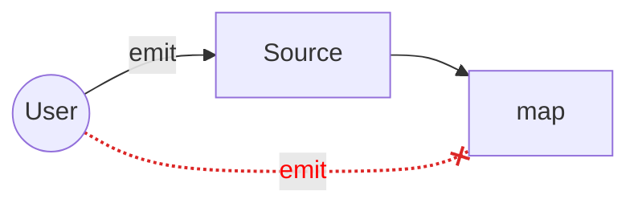

# Getting Started

## System Requirements

- Python 3.8+
- No Rust toolchain required — pre-built wheels are distributed via pip

## Installation

/// tab | pip

```bash
pip install akayu
```

///

/// tab | uv

```bash
uv add akayu
```

///

/// tab | pixi

```bash
pixi add akayu
```

///

## Verify Installation

```bash
python -c "import akayu; print('akayu installed!')"
```

## Basic Usage

### Creating a Stream

Every pipeline starts with a source `Stream`:

```python
import akayu

source = akayu.Stream()
```

### Building Pipelines

Chain operations to build your processing pipeline:

```python
import akayu

source = akayu.Stream()

# Transform values
doubled = source.map(lambda x: x * 2)

# Filter values
filtered = doubled.filter(lambda x: x > 10)

# Consume values
results = []
filtered.sink(results.append)
```

### Emitting Data

!!! warning "Source Nodes Only"
    Data can only be emitted into **source** nodes (nodes created with `Stream()`). Trying to emit data into derived nodes (like those returned by `.map()` or `.filter()`) raises a `RuntimeError`.



```python
# Single item
source.emit(5)

# Multiple items (more efficient)
source.emit_batch([1, 2, 3, 4, 5])
```

### To compile or not to compile?

The `compile()` step enables graph optimizations but is **optional**.

**What compile() does:**
- **Operator fusion** — Chains of `map.map.map` become a single fused operation
- **Graph locking** — Prevents accidental modifications after optimization
- **State initialization** — Prepares accumulate states upfront

**When to use it:**
- Production pipelines processing high volumes
- Hot loops where overhead matters
- When you want protection against accidental graph mutation

**When to skip it:**
- Debugging — uncompiled graphs are easier to inspect
- Dynamic pipelines — you need to add/remove nodes at runtime
- Rapid prototyping — faster iteration without recompiling

```python
# Optional but recommended for production
source.compile()
source.emit_batch(data)
```

## Common Mistakes

### Emitting to a non-source node

```python
source = akayu.Stream()
mapped = source.map(lambda x: x * 2)

mapped.emit(5)  # ❌ RuntimeError: Cannot emit to non-source node
```

**Error:**
```
RuntimeError: Cannot emit to non-source node. Only source nodes (created with Stream()) can receive data.
```

**Fix:** Always emit to the original source node:

```python
source.emit(5)  # ✅ Correct
```

## Naming Streams for Debugging

Every operation accepts an optional `stream_name` parameter. Names appear in error messages, making it easy to trace problems in complex pipelines.

```python
source = akayu.Stream(name="input")
doubled = source.map(lambda x: x * 2, stream_name="double")
filtered = doubled.filter(lambda x: x > 10, stream_name="filter_gt_10")
```

If an error occurs, the name is included:

```
RuntimeError: Emit called on non-source node 'double'. ...
```

All transform methods support `stream_name`: `map`, `filter`, `sink`, `flatten`,
`collect`, `prefetch`, `accumulate`, `chunk_by`, `starmap`, `batch_map`.

If not provided, a default name is generated from the function name (e.g. `"map(my_func)"`).

## Available Operations

### Transformations

- [`#!python map(func)`](api.md#akayu.Stream.map) — Transform each element
- [`#!python filter(predicate)`](api.md#akayu.Stream.filter) — Keep matching elements
- [`#!python flatten()`](api.md#akayu.Stream.flatten) — Expand iterables into individual items
- [`#!python accumulate(func, start)`](api.md#akayu.Stream.accumulate) — Running aggregation
- [`#!python batch_map(func)`](api.md#akayu.Stream.batch_map) — Vectorized batch transformation
- [`#!python starmap(func)`](api.md#akayu.Stream.starmap) — Map with argument unpacking
- [`#!python chunk_by(predicate)`](api.md#akayu.Stream.chunk_by) — Buffer until delimiter, emit as tuple
- [`#!python prefetch(n)`](api.md#akayu.Stream.prefetch) — Enable concurrent processing for next map
- [`#!python sink(func)`](api.md#akayu.Stream.sink) — Terminal side-effect operation

### Collecting

- [`#!python collect()`](api.md#akayu.Stream.collect) — Buffer elements until `flush()`
- [`#!python to_list()`](api.md#akayu.Stream.to_list) — Collect into a Python list
- [`#!python to_set()`](api.md#akayu.Stream.to_set) — Collect into a Python set
- [`#!python drain()`](api.md#akayu.Stream.drain) — Discard all elements

### Combining Streams

- [`#!python union(*streams)`](api.md#akayu.Stream.union) — Merge multiple streams
- [`#!python zip(*streams)`](api.md#akayu.Stream.zip) — Pair items from multiple streams
- [`#!python combine_latest(*streams)`](api.md#akayu.Stream.combine_latest) — Latest value from each stream

## Example: Processing Pipeline

```python
import akayu

def process_record(record):
    return {"id": record["id"], "value": record["value"] * 2}

def is_valid(record):
    return record["value"] > 0

# Build pipeline
source = akayu.Stream()
results = []

source.filter(is_valid).map(process_record).sink(results.append)

# Compile for performance
source.compile()

# Process data
records = [
    {"id": 1, "value": 10},
    {"id": 2, "value": -5},
    {"id": 3, "value": 20},
]
source.emit_batch(records)

print(results)
# [{'id': 1, 'value': 20}, {'id': 3, 'value': 40}]
```

## Next Steps

- [Starter Patterns](patterns.md#starter-patterns) — Common patterns with examples
- [Advanced Patterns](patterns.md#patterns--best-practices) — Concurrency, batching, anti-patterns
- [API Reference](api.md) — Full method documentation
