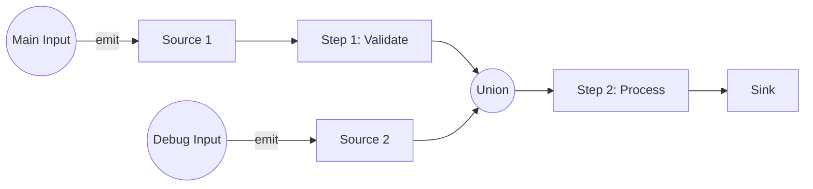
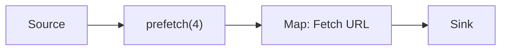
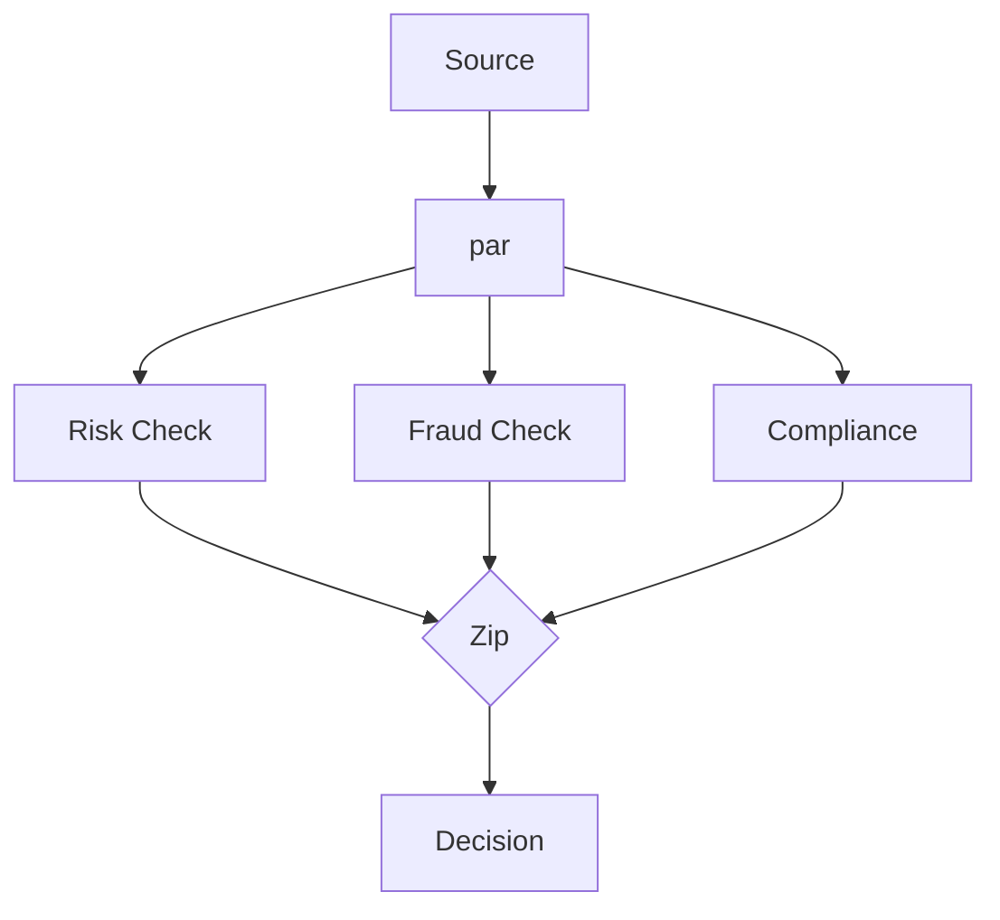
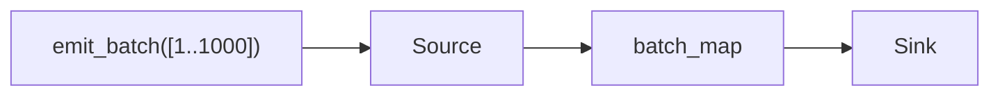

# Patterns & Best Practices

## Starter Patterns

### Simple Transform

Basic map → filter → sink pipeline:

```python
import akayu

source = akayu.Stream()
results = []

source.map(lambda x: x * 2).filter(lambda x: x > 5).sink(results.append)

source.compile()
source.emit_batch(range(10))

print(results)  # [6, 8, 10, 12, 14, 16, 18]
```

### Multiple Sinks

Branch to multiple consumers with `par()`:

<!--pytest.mark.skip-->

```python
import akayu

source = akayu.Stream()

# Fan out to three independent sinks
p = source.par()
p.map(enrich_with_metadata).sink(store_to_db)
p.map(validate).filter(is_valid).sink(publish_valid)
p.map(validate).filter(lambda x: not is_valid(x)).sink(publish_invalid)

source.compile()
```

### Accumulate/Reduce

Running aggregation with `accumulate()`:

```python
import akayu

source = akayu.Stream()

# Running sum
source.accumulate(lambda acc, x: acc + x, start=0).sink(print)

source.emit_batch([1, 2, 3, 4, 5])
# 1
# 3
# 6
# 10
# 15
```

### Testing a Pipeline

Use `union()` to inject test data without modifying your pipeline:

```python
import akayu


def build(source):
    """Build the pipeline on any source, so tests can use a fresh one."""
    return source.map(lambda x: x * 2).filter(lambda x: x > 2)


# In a test: build on a fresh source, collect the output, assert on it
source = akayu.Stream()
results = build(source).to_list()
source.emit_batch([1, 2, 3])
assert results == [4, 6]
```

## Injecting Data Midway (The "Side-Door" Pattern)

A common requirement is to inject data into the middle of a pipeline—either for testing specific components in isolation or for merging control signals. Since `akayu` restricts `emit()` to source nodes only, you cannot simply call `emit()` on an intermediate node.

**The Solution**: Use `union()` to attach a secondary "injection" Source node at the desired point.



### Example Code

```python
import akayu

main_source = akayu.Stream(name="main")
debug_source = akayu.Stream(name="debug")

# Standard pipeline flow: validation drops negative values
pipeline = main_source.filter(lambda x: x >= 0)

# Merge debug source before the expensive processing step
# Both valid main data AND debug data will flow into the processing step
processed = []
pipeline.union(debug_source).map(lambda x: x * 10).sink(processed.append)

main_source.compile()

# Normal operation
main_source.emit(5)
main_source.emit(-3)  # rejected by validation

# Test/Debug operation (skips validation)
debug_source.emit(-1)

assert processed == [50, -10]
```

## Concurrency Strategies

Choosing between `par()` and `prefetch()` depends on your bottleneck.

### Strategy A: The I/O Scaler (`prefetch`)

Use `prefetch()` when your pipeline is bound by latency (waiting for external resources) rather than CPU work.

- **Best For**: API calls, Database queries, File downloads.
- **Pros**: Simple syntax, strictly preserves order, controls concurrency limit.



<!--pytest.mark.skip-->

```python
import akayu

source = akayu.Stream()
# Keep 4 requests in flight at once
source.prefetch(4).map(requests.get).sink(save_response)
```

### Strategy B: The Scatter-Gather (Diamond Pattern)

Use `par()` combined with `zip()` or `union()` when you need to perform multiple independent analyses on the same data item.

- **Best For**: Multi-model inference, enriching data from multiple sources.



```python
import akayu

source = akayu.Stream()
p = source.par()

# Independent checks running in parallel
risk = p.map(lambda order: order["amount"] > 1000)
fraud = p.map(lambda order: order["country"] not in {"US", "CA"})
compliance = p.map(lambda order: "id" in order)

# Wait for all 3 to finish, then combine results
decisions = []
akayu.zip(risk, fraud, compliance).map(
    lambda checks: "review" if checks[0] or checks[1] or not checks[2] else "approve"
).sink(decisions.append)

source.emit({"id": 1, "amount": 50, "country": "US"})
source.emit({"id": 2, "amount": 5000, "country": "US"})
assert decisions == ["approve", "review"]
```

## Batch Processing Integration

When working with data science libraries like NumPy or Pandas, processing item-by-item kills performance.

**The Pattern**: Always pair `emit_batch()` at the source with `batch_map()` in the pipeline. This ensures the data stays in efficient vector formats (like Lists or Arrays) throughout the pipeline.



<!-- pytest-codeblocks:importorskip(numpy) -->

```python
import akayu

import numpy as np

source = akayu.Stream()

# Function receives the whole list/array, not one item
def vector_op(batch):
    arr = np.array(batch)
    return arr * 2  # Vectorized multiplication

results = []
source.batch_map(vector_op).sink(results.append)

# Efficiently push chunks of data
source.emit_batch([0, 1, 2, 3, 4])
assert [int(x) for x in results] == [0, 2, 4, 6, 8]
```

## Anti-Patterns

### 1. The "Late Modification"

Attempting to modify the graph after `compile()` will crash your application.

<!--pytest.mark.xfail(strict=True)-->

```python
import akayu

s = akayu.Stream()
s.map(lambda x: x + 1)
s.compile()

s.map(lambda x: x * 2)  # ❌ RuntimeError: Graph is locked
```

**Fix**: Define the entire topology before calling compile.

### 2. The Trivial Parallelism

Using `par()` for cheap operations (like simple arithmetic) often makes code *slower* due to thread switching overhead.

<!--pytest.mark.skip-->

```python
# ❌ Anti-Pattern: Parallelizing trivial math
s.par().map(lambda x: x + 1) 
```

**Fix**: Only parallelize tasks that take >1ms (I/O, heavy compute). For simple math, standard sequential processing is faster.
